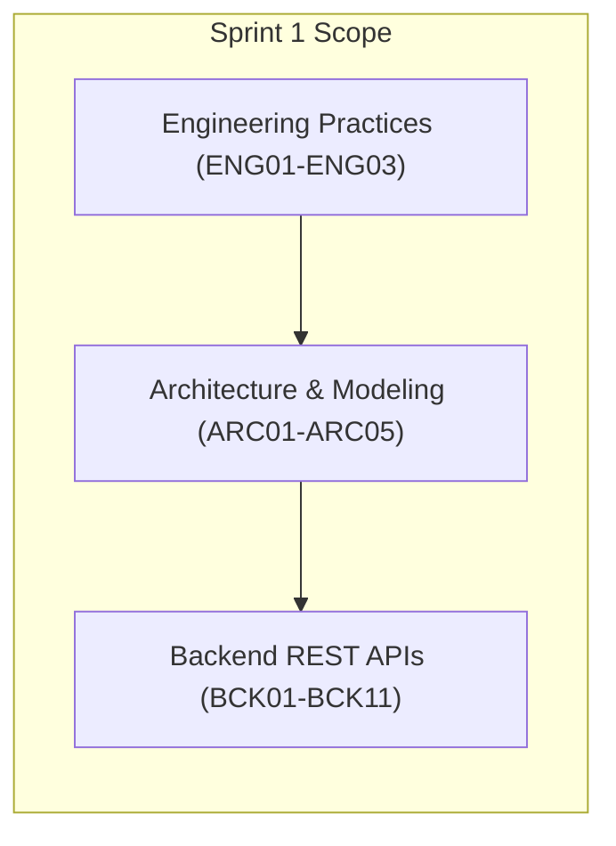

# LaPrizza – Integrative Project (LEI-ISEP 2026/2027)

> **Repository**: `LEI-SEM5-PI-2026-27-3DL-E-A`  
> **Degree**: Licenciatura em Engenharia Informática (LEI) — [ISEP](https://www.isep.ipp.pt)  
> **Academic Year**: 2026/2027 | 5th Semester  
> **Participating Course Units**: LAPR5, ARQSI, SGRAI, IART, ASIST  

---

## 🍕 Project Overview

**LaPrizza** is a modern pizza restaurant information system designed to support and automate end-to-end business and operational workflows. The platform integrates:

* **Core Business & Web Application**: Customer management, allergen and product catalogues, pizza customization rules, and order processing.
* **3D Visualization & Interaction**: Interactive 3D "Build Your Pizza" interface and real-time kitchen preparation visualization (WebGL / Three.js).
* **Artificial Intelligence**: Production scheduling and kitchen resource allocation algorithms developed in Prolog.
* **Systems Administration & Infrastructure**: Containerization, high-availability deployments, security, and automated backups (Docker, Reverse Proxy).

The project is developed across three iterative sprints over a 14-week lifecycle.

---

## 📚 Project Specifications & References

The authoritative requirements, domain concepts, and sprint goals are documented in the specification documents located under [`docs/sprint1/project specifications/`](docs/sprint1/project%20specifications/):

| Document | Description | Link |
| :--- | :--- | :--- |
| **Part II – System Specification** | Comprehensive Request for Proposal (RFP) detailing the business domain, customers, products, allergens, pizza sizes/components, stock-unit abstraction, order workflows, and technological areas. | [System Specification (PDF)](docs/sprint1/project%20specifications/LEI-2026-27-Sem5-Project_v1-SystemSpecification.pdf) |
| **Part III – Sprint 1 User Stories** | Specific backlog, User Stories, acceptance criteria, and deliverable guidelines for the first iteration (Sprint 1: Sept 14 – Oct 25, 2026). | [Sprint 1 User Stories (PDF)](docs/sprint1/project%20specifications/LEI-2026-27-Sem5-Project_v1-Sprint1US.pdf) |

---

## 🎯 Sprint 1 Focus & User Stories

Sprint 1 establishes the engineering environment, core domain modeling, system architecture, and initial REST API backend implementation (**LAPR5** and **ARQSI**).



### 1. Engineering Practices (`ENG`)
* **`ENG01`** – Project repository setup, branching strategy, documentation, and sprint submission tagging.
* **`ENG02`** – Sprint planning, task decomposition, and project board monitoring.
* **`ENG03`** – Self and peer evaluations.

### 2. Architecture & Domain Modeling (`ARC`)
* **`ARC01`** – Core domain analysis and modeling (Customers, Products, Allergens, Sizes, Stock, Orders, Kitchen).
* **`ARC02`** – System architecture specification (Onion / Clean Architecture, C4 diagrams, ADRs).
* **`ARC03`** – REST API design standards and OpenAPI / Swagger documentation.
* **`ARC04`** – Persistence model, uniqueness constraints, and data integrity.
* **`ARC05`** – Automated unit and integration testing strategy.

### 3. Back-End Functionality (`BCK`)
* **`BCK01`** – User & authentication management (roles, secure credentials).
* **`BCK02`** – Customer management & dietary restrictions.
* **`BCK03`** – Product category catalogue & referential integrity.
* **`BCK04`** – Allergen management & product associations.
* **`BCK05`** – Product management (sellable, stock-controlled, pizza component roles).
* **`BCK06`** – Pizza size management.
* **`BCK07`** – Pizza component types (assembly ordering, min/max limits).
* **`BCK08`** – Pizza component size configurations (size-dependent pricing and stock consumption).
* **`BCK09`** – Stock information management using the abstract stock-unit model.
* **`BCK10`** – Predefined pizza management & default configuration validation.
* **`BCK11`** – Customer product catalogue & details consultation.

---

## 🏗️ Repository Layout

```text
.
├── .gitignore              # Repository-wide Git ignore rules
├── README.md               # Main project overview and reference index
├── backend/                # Backend service (Node.js + TypeScript + Express)
│   ├── .editorconfig       # Formatting consistency rules
│   ├── .env.example        # Environment variable template
│   ├── .gitignore          # Backend-specific ignore rules
│   ├── .prettierrc         # Code formatting configuration
│   ├── eslint.config.mjs   # ESLint v9 configuration
│   ├── jest.config.js      # Jest test runner setup
│   ├── package.json        # Dependencies and scripts
│   ├── tsconfig.json       # TypeScript compiler settings
│   ├── README.md           # Backend-specific setup, execution & DDD guide
│   ├── src/
│   │   ├── app.ts          # Express plumbing, CORS, logging, Swagger, error handler
│   │   └── server.ts       # Server entry point
│   └── tests/
│       └── health.test.ts  # Automated health check integration test
└── docs/                   # Project documentation and specifications
    └── sprint1/
        └── project specifications/
            ├── LEI-2026-27-Sem5-Project_v1-Sprint1US.pdf
            └── LEI-2026-27-Sem5-Project_v1-SystemSpecification.pdf
```

---

## 🚀 Quick Start Guide

### Prerequisites
* **Node.js**: `v20.x` or higher (verified on `v24.x`)
* **npm**: `v10.x` or higher
* **Git**

### Running the Backend
1. Enter the backend directory and install dependencies:
   ```bash
   cd backend
   npm install
   ```

2. Copy environment configuration:
   ```bash
   cp .env.example .env
   ```

3. Launch in development mode:
   ```bash
   npm run dev
   ```

4. Verify services:
   * **Health Check**: `GET http://localhost:3000/api/v1/health`
   * **Swagger UI API Documentation**: `http://localhost:3000/api-docs`

### Running Automated Tests
```bash
cd backend
npm test
```

---

## 🌿 Git Strategy & Workflow (`ENG01`)

* **Main Branch**: `main` — protected, stable release branch.
* **Feature Branches**: `feat/<us-code>-<short-description>` (e.g. `feat/bck01-user-auth`).
* **Bugfix Branches**: `fix/<short-description>`.
* **Sprint Deliverable Tag**: Each sprint submission must be tagged strictly following:
  ```bash
  git tag sprint-1-submission
  git push origin sprint-1-submission
  ```
  *(Once tagged and submitted on Moodle, the tag must not be modified or moved).*
