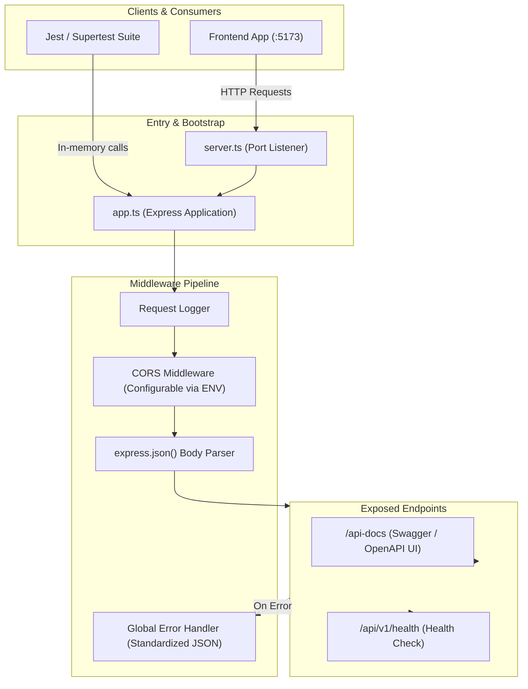
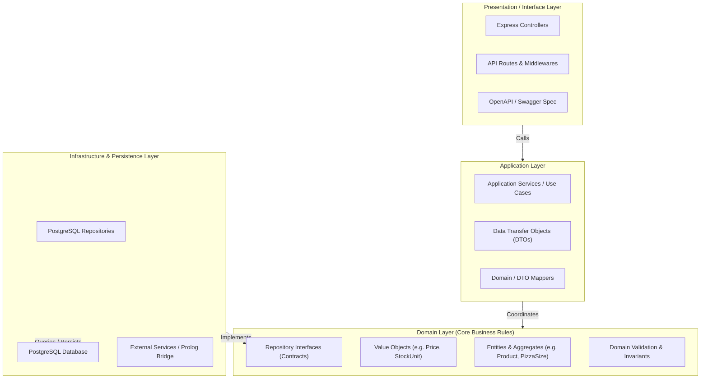

# Backend Starter Skeleton

This repository contains the domain-agnostic technical skeleton for the project backend. It provides the initial tooling, configuration, basic plumbing, OpenAPI documentation, and a health-check endpoint.

> **Note on Architecture & Technology Choice**: The Request for Proposal (RFP) does not mandate any specific technology, framework, or architectural style for this component of the system. The chosen technology stack (Node.js, TypeScript, Express) and the architectural approach to be implemented must be justified and documented by the development team.

---

## Prerequisites & Runtimes

* **Node.js**: `v20.x` or higher (verified with `v24.x`)
* **npm**: `v10.x` or higher (verified with `v11.x`)

---

## Installation

1. Navigate to the `backend` folder:
   ```bash
   cd backend
   ```

2. Install dependencies:
   ```bash
   npm install
   ```

---

## Configuration

1. Copy the example environment file:
   ```bash
   cp .env.example .env
   ```

2. Available environment variables:
   * `PORT`: Server listening port (default: `3000`).
   * `NODE_ENV`: Application environment (`development`, `test`, `production`).
   * `CORS_ORIGIN`: Allowed origin for incoming frontend requests (default: `http://localhost:5173`).

---

## Running the Application

* **Development mode** (with hot reload):
  ```bash
  npm run dev
  ```
* **Build TypeScript**:
  ```bash
  npm run build
  ```
* **Production mode**:
  ```bash
  npm start
  ```

Once running:
* **Health endpoint**: `GET http://localhost:3000/api/v1/health`
* **API Documentation (Swagger UI)**: `http://localhost:3000/api-docs`

---

## Running Tests

Run the test suite via Jest:
```bash
npm test
```

Run linter:
```bash
npm run lint
```

Format code:
```bash
npm run format
```

---

## Architecture & Design Decisions

### 1. Current Starter Skeleton Flow

The diagram below visualizes the decoupled setup between server initialization, middleware plumbing, and endpoints:



### 2. Target Onion / Clean Architecture (Sprint 1 - ARC02)

As the team begins implementing the Sprint 1 business User Stories (`BCK01`–`BCK11`), the application follows Domain-Driven Design (DDD) with Dependency Inversion:



---

## Extending the Project

This skeleton deliberately contains **no** domain logic, database connections, or architecture-specific layers.

The team should structure future development under `src/` following the Onion / Clean Architecture shown above:
* **Domain Layer** (`src/domain/`): Pure business entities, value objects, aggregates, and repository interfaces with no external dependencies.
* **Application Layer** (`src/application/`): Use cases, application services, and DTOs coordinating domain operations.
* **Infrastructure Layer** (`src/infrastructure/`): PostgreSQL database connections, repository implementations, and data mappers.
* **Interface / Presentation Layer** (`src/api/`): Express controllers, input validation schemas, and route registrations.

